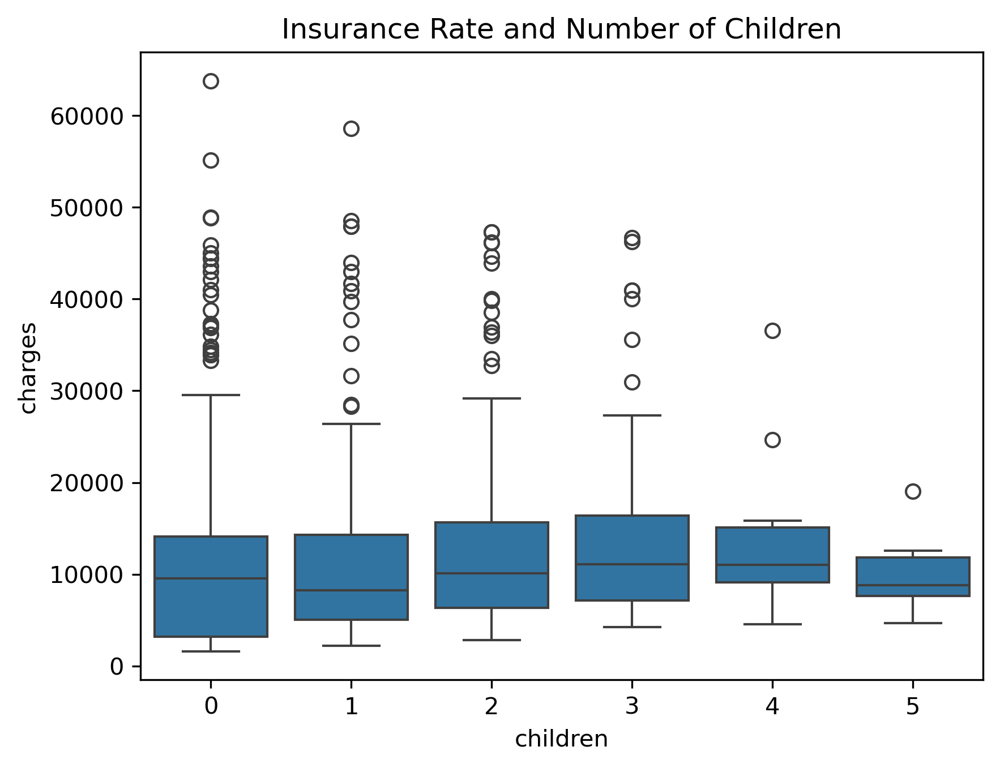
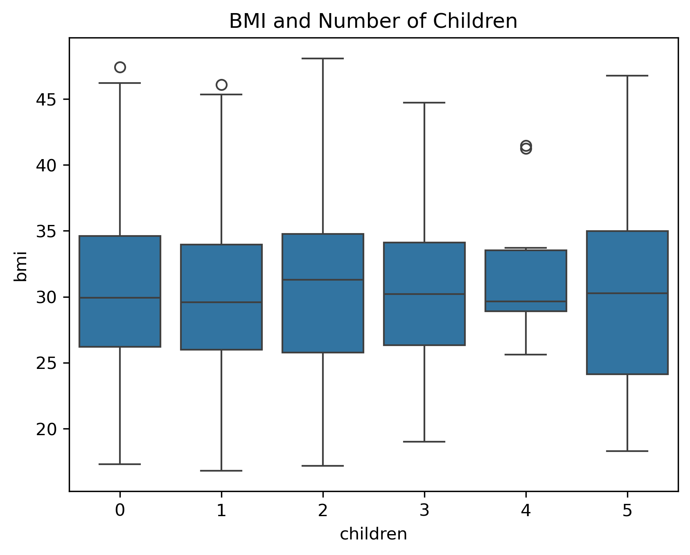

#Female Health and Cost Analysis
An exploratory data analysis investigating the correlation between the female sex and various medical related variables such as US Medical Insurance rate, and BMI. 

##Key Insights
* **Males vs Females:** Males actually pay higher insurance rates on average than females, regardless of any other factors, by roughly $1,400.
* **The Bell Curve:** Females with one child and 5 children paid roughly the same average in insurance rate, with those with no children paying the least on average and those with 3 paying the most on average.
* **Equal BMIs:** No matter the number of children, females showed roughly the same average BMI, with a small, likely insignificant higher average in those with two children than any other number.

##Visualizations Showcase

*Figure 1: Comparative cost analysis showing slight skewed bell curve over number of children.*

*Figure 2: Comparative health metric analysis against number of chilren.*

##Data Stack & Methodology
* **Language:** Python
* **Libraries:** Pandas (data manipulation), Seaborn & Matplotlib (advanced data visualization)
* **Dataset:** Sourced from Kaggle, the Medical Cost Personal Dataset from the *Machine Learning with R* book by Brett Lantz.

##Questions Addressed
1. Do females, regardless of any other factor, pay higher, lower, or equal insurance rates than males?
2. Do females with children pay more or less than females with no children?
3. Do females with more children have higher, lower, or equal BMIs, to those with less or zero children?
